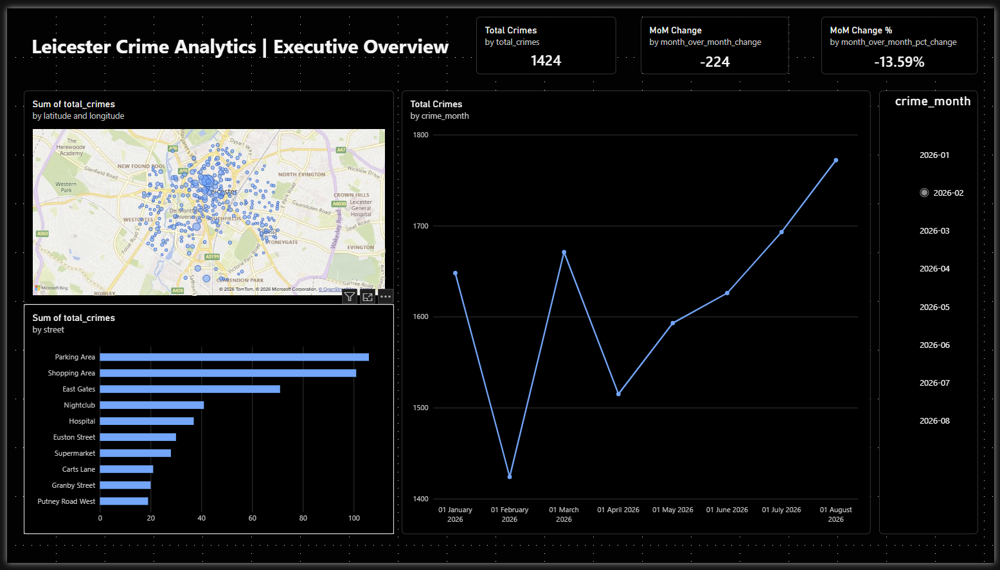
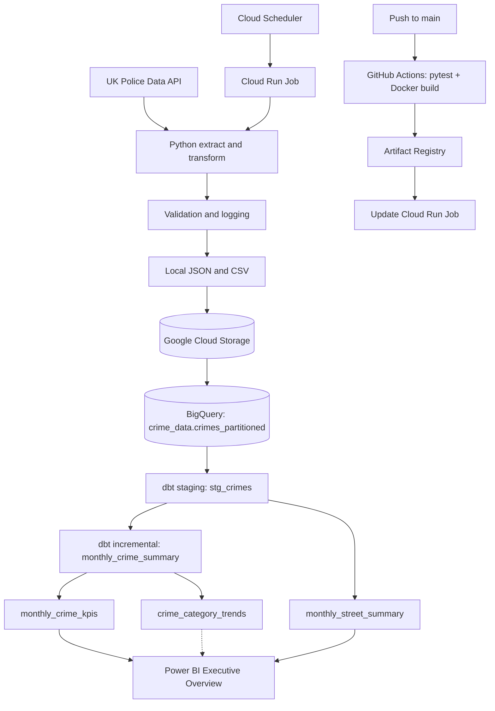

# UK Crime Data Pipeline & Analytics

**An end-to-end, containerised data engineering project using Python, Google Cloud, BigQuery, dbt, GitHub Actions, and Power BI.**

The system collects street-level crime records from the [UK Police Data API](https://data.police.uk/), cleans and validates them, stores JSON/CSV files in Google Cloud Storage (GCS), loads month-partitioned BigQuery data, and builds tested analytics models with dbt. A scheduled Cloud Run Job refreshes the pipeline, and GitHub Actions tests and deploys code changes. A **single-page Power BI Executive Overview** visualises reported-crime trends and approximate geographic distribution for the Leicester study area.

> **Scope:** This is a project-based engineering portfolio, not a production service for a police force. Data originates from an API query around a specified Leicester-area latitude/longitude, **not all UK crime records**. Public police crime locations are anonymised/approximate; maps must not be interpreted as exact incident addresses.

## Dashboard

The Power BI report currently contains **one Executive Overview page** with:

- Reported-crime count for the selected month
- Month-over-month (MoM) change and percentage, where a valid comparison exists
- Monthly reported-crime line chart
- Top 10 reported location/street labels
- Map of approximate, aggregated reported-crime locations around Leicester
- Reporting-month slicer that filters the cards, bar chart, and map



## Architecture



See [docs/architecture.md](docs/architecture.md) for the execution, deployment, modelling, and permissions architecture.

## Technology stack

| Layer | Technology | Purpose |
|---|---|---|
| Ingestion and transformation | Python, requests | Fetch, clean, validate, and export API records |
| Testing and diagnostics | pytest, logging | Test code paths and diagnose execution failures |
| Object storage | Google Cloud Storage | Store processed JSON and CSV extracts |
| Data warehouse | BigQuery | Load and query crime data partitioned by `crime_month` |
| Analytics engineering | dbt Core + dbt-bigquery | Build staging models, incremental summaries, marts and tests |
| Packaging | Docker | Package Python, dbt and project files |
| Image registry | Google Artifact Registry | Store deployable Docker images |
| Cloud execution | Cloud Run Jobs | Execute the pipeline using a dedicated service account |
| Scheduling | Cloud Scheduler | Trigger monthly refreshes |
| CI/CD | GitHub Actions | Run Python tests, build/push images, update Cloud Run Job |
| Reporting | Power BI Desktop | Interactive, single-page executive dashboard |

## Processing and modelling

1. **Determine the processing month.** An explicit `CRIME_DATE=YYYY-MM` permits manual backfills. Otherwise, the orchestrator queries the Police API's latest-available crime month.
2. **Extract and clean records.** The ingestion stage handles request errors, normalises selected fields, logs execution, and writes JSON/CSV.
3. **Upload extracts.** Files are stored in GCS under month-specific paths such as `cleaned/2026-02/cleaned_crime_data.csv`.
4. **Load BigQuery.** The Python loader writes to the relevant date partition of `crime_data.crimes_partitioned` using a partition decorator and `WRITE_TRUNCATE`. Rerunning a month replaces that partition rather than appending duplicate records.
5. **Transform and test.** `dbt build` builds the staging and analytical models and runs configured dbt data-quality tests. Python's subprocess execution fails if dbt returns a nonzero exit code.
6. **Visualise.** Power BI imports analytics-ready BigQuery models. Its Import-mode data must be **refreshed separately** to reflect newer BigQuery data.

### BigQuery and dbt models

| Model/table | Grain and responsibility |
|---|---|
| `crime_data.crimes_partitioned` | Crime records partitioned by `crime_month` |
| `crime_dbt_dev.stg_crimes` | Standardised view of source records |
| `crime_dbt_dev.monthly_crime_summary` | Incrementally maintained monthly counts by crime category |
| `crime_dbt_dev.monthly_crime_kpis` | Monthly totals and month comparison metrics |
| `crime_dbt_dev.crime_category_trends` | Category-level trends across reporting months |
| `crime_dbt_dev.monthly_street_summary` | Counts and representative coordinates by street label and month |

**Analytics quality caveat:** A simple SQL `LAG()` compares the previous *available row*, not necessarily the previous calendar month. MoM metrics must only be labelled “month-over-month” when a preceding calendar month exists. Backfilled months should be followed by a dbt full refresh / historical recomputation and validation before publishing results.

## Automation

**Data refresh:** Cloud Scheduler calls the Cloud Run Job. The job chooses the latest available month (unless a backfill override is provided), runs ingestion, loads BigQuery and invokes dbt tests.

**Code deployment:** Pushes to `main` trigger GitHub Actions: dependency installation, `pytest`, Docker build, short-lived Workload Identity Federation authentication, image push to Artifact Registry, and update of the Cloud Run Job. Pull requests are for validation, not production deployment. The deployed image uses a Git commit-based tag for traceability.

These are different automations: Cloud Scheduler refreshes **data**, while GitHub Actions deploys **code**.

## Local development

Prerequisites: Python 3.13, Docker, Google Cloud CLI, BigQuery access, and appropriate GCP authentication/permissions.

```powershell
python -m pip install -r requirements.txt
python -m pytest -v
python orchestrate.py
```

The local orchestrator uses `CRIME_DATE` if supplied, otherwise queries the source for its latest month. Configure non-secret variables with `.env.example` as the template; **do not commit `.env` or service-account keys**. The local dbt profile is located at `crime_dbt/profiles.yml` and is configured through environment variables.

Example non-secret configuration keys:

```dotenv
POLICE_API_URL=https://data.police.uk/api/crimes-street/all-crime
# CRIME_DATE=2026-02  # Optional manual backfill
LATITUDE=52.629729
LONGITUDE=-1.131592
GCS_BUCKET_NAME=uk-crime-raw-23092026
GCP_PROJECT_ID=uk-crime-data-pipeline-509515
GCP_REGION=europe-west2
BIGQUERY_DATASET=crime_data
BIGQUERY_TABLE=crimes_partitioned
BIGQUERY_DBT_DATASET=crime_dbt_dev
```

To build dbt independently after ingestion:

```powershell
dbt build --project-dir crime_dbt --profiles-dir crime_dbt --no-partial-parse
```

To backfill a particular month without changing the stored Cloud Run Job configuration:

```powershell
gcloud run jobs execute uk-crime-pipeline-job `
  --project=uk-crime-data-pipeline-509515 `
  --region=europe-west2 `
  --update-env-vars=CRIME_DATE=2026-03 `
  --wait
```

Requires access to the GCP project; these examples are not expected to work for anonymous repository visitors.

## Data quality and verification

- `pytest` exercises extraction, transformation, local persistence, cloud helper calls and orchestration with mocks.
- dbt schema and singular tests check required values, positive totals and uniqueness of month/category aggregates.
- Successful Cloud Run executions and GitHub Actions workflows show cloud and deployment health, but individual report values should also be validated against BigQuery.
- The public location labels may refer to places like “Shopping Area” or “Parking Area” and should not be treated as unique street identifiers.

## Repository contents

```text
.
├── extract.py
├── transform.py
├── load.py
├── main.py
├── orchestrate.py
├── tests/
├── crime_dbt/
│   ├── profiles.yml
│   ├── models/staging/
│   └── models/marts/
├── Dockerfile
├── requirements.txt
├── .github/workflows/
└── docs/
    ├── architecture.md
    └── images/
        └── executive_overview.png
```

## Limitations and next improvements

- Data covers a specified Leicester-area API query, not the whole United Kingdom.
- Source positions are approximate/anonymised; aggregating by street label can combine distinct places with the same label.
- Power BI is currently a **one-page** report, with imported data refreshed separately.
- Source availability can lag; the pipeline selects the latest published month instead of assuming the previous calendar month is available.
- Historical completeness and consecutive-month checks must be verified for valid MoM statements.

## References

- [UK Police Data API](https://data.police.uk/docs/)
- [Google Cloud Run Jobs](https://cloud.google.com/run/docs/create-jobs)
- [BigQuery](https://cloud.google.com/bigquery/docs)
- [dbt documentation](https://docs.getdbt.com/)
- [Power BI documentation](https://learn.microsoft.com/power-bi/)

---

**Project:** [Rohit-Roby/uk-crime-data-pipeline](https://github.com/Rohit-Roby/uk-crime-data-pipeline)
