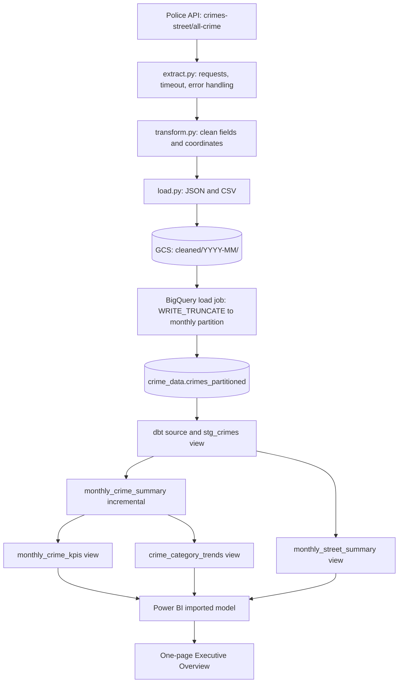
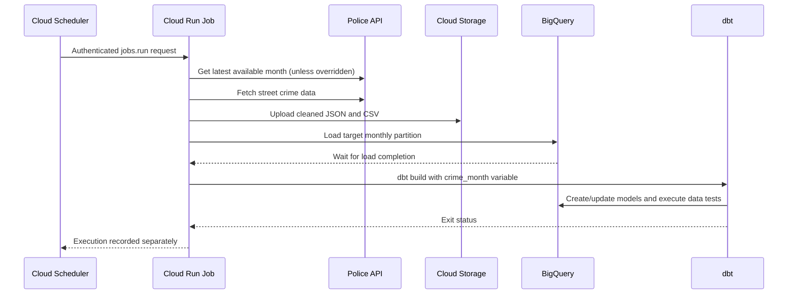
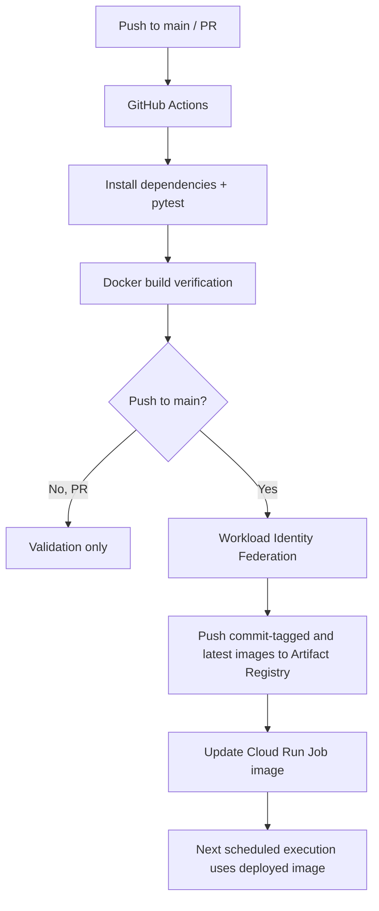
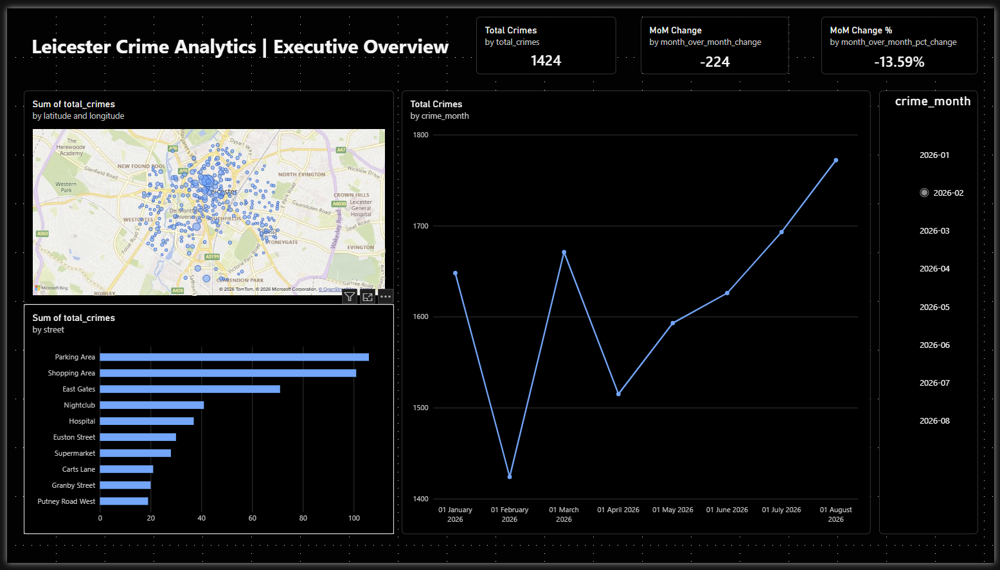

# UK Crime Data Pipeline — Technical Architecture

## 1. System context

The UK Police Data API is the upstream source. A containerised Python program retrieves, cleans, and stores reported crime data for a Leicester-area geographic query. BigQuery stores partitioned records, dbt generates analytical models, and Power BI provides a **single-page Executive Overview**. Cloud Scheduler controls recurring data execution. GitHub Actions handles validation and deployment of source changes.

## 2. Data-plane detail

### Data contracts and grain

| Data object | Grain | Usage |
|---|---|---|
| `crimes_partitioned` | One cleaned crime record | Partitioned source table |
| `stg_crimes` | One cleaned crime record | Standardised staging view |
| `monthly_crime_summary` | One month × category | Incremental category counts |
| `monthly_crime_kpis` | One month | Executive totals and comparisons |
| `crime_category_trends` | One month × category | Category analysis |
| `monthly_street_summary` | One month × location label | Counts and representative coordinates |

**Month representations:** `CRIME_DATE=YYYY-MM` selects the API month and GCS path; BigQuery uses `crime_month=YYYY-MM-01` (DATE); the partition decorator uses `YYYYMMDD`.

**Idempotency:** Monthly ingestion targets the specific BigQuery partition with `WRITE_TRUNCATE`. The dbt monthly summary is maintained incrementally using partition overwrite.

**Data freshness:** If `CRIME_DATE` is unset, the orchestrator queries `https://data.police.uk/api/crime-last-updated` and selects the latest published month. A backfill may pass a specific historical month at execution time.

**Correctness constraint:** `LAG()` is a previous-row lookup, not a calendar-contiguity guarantee. Month-over-month metrics must validate a one-month difference between reporting dates or use a complete calendar scaffold. Historical backfills require rebuilding/recomputing affected models to avoid stale comparisons.

## 3. Scheduled execution / control plane

The scheduler triggers an execution; it does not itself execute ETL or wait for all analytics to finish. Cloud Run execution logs and status are used to verify successful completion. A scheduled job repeats even if the latest available source month has not changed; partition replacement makes reruns idempotent at the warehouse-load level.

## 4. CI/CD deployment architecture

GitHub Actions uses a separate **deployer** service account with permissions for Artifact Registry and Cloud Run updates. Cloud Run itself runs as the **pipeline runner** service account. Scheduler uses its own **invoker** service account. No Google service-account JSON key is baked into the image or committed to GitHub.

### IAM identities (logical roles)

| Identity | Responsibility |
|---|---|
| Pipeline runner | Access GCS, submit BigQuery jobs, read/write relevant datasets while executing |
| Scheduler invoker | Invoke the configured Cloud Run Job |
| CI/CD deployer | Upload images and deploy updates to Cloud Run, with service-account act-as permission as needed |

Use dataset- and repository-scoped IAM where practical. Avoid giving build/deploy identities unnecessary access to crime records.

## 5. Power BI model and report

Power BI imports three dbt marts: `monthly_crime_kpis`, `crime_category_trends`, and `monthly_street_summary`. A `DimMonth` table can provide a common reporting-month slicer with one-way relationships to these tables. Each source has a different grain; arbitrary joins between category and street aggregates can double-count data or imply nonexistent category-by-street breakdowns.

The **single Executive Overview page** contains monthly KPI cards, a monthly trend chart, a Top 10 location-label bar chart, a bubble map, and a shared month selector. The source geographic query is Leicester-area, not nationwide; the map plots approximate/aggregated positions. Power BI Import refresh is a separate concern from Cloud Scheduler's BigQuery refresh.

> Replace the screenshot path above with your finished Power BI image at `docs/images/executive_overview.png`.

## 6. Validation and failure handling

- Python unit/integration-style tests run with pytest and mocks for external dependencies.
- dbt `build` runs staging and mart transformations plus configured schema/singular tests.
- Python waits for BigQuery load completion before invoking dbt.
- `subprocess.run(..., check=True)` propagates a dbt process failure to the Cloud Run execution.
- Cloud Run logs allow tracing extraction, upload, warehouse load, dbt build, and exceptions.
- Verify reporting-month coverage and calendar adjacency before claiming MoM comparisons.

## 7. Operational limitations

- The current solution uses the Police API's anonymised approximate street-level crime data.
- Location labels are not guaranteed unique or precise geographic addresses.
- Cloud Run Jobs and Power BI refresh are independently managed; a successful Cloud Run run does not automatically update an imported `.pbix`.
- This project is demonstrated as a portfolio architecture. Further production hardening could include alerting, dataset-specific IAM tightening, freshness checks, cost monitoring and separate backfill/orchestration stages.
